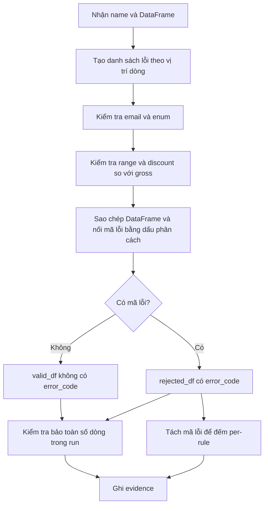

# Bài 2: Business Rules Validation — Quy trình xử lý với AI

Tài liệu ghi lại các bước AI đã thực hiện trong phiên xử lý Bài 2, các thay đổi cụ thể và kết quả chạy đã ghi nhận. Nội dung được đối chiếu với mã nguồn, kiểm thử và evidence khi tạo tài liệu ngày 20/10/2026.

## 1. Yêu cầu và đầu ra

Nguồn yêu cầu: [Bài 2 trong đề MD01-B7](../../assignments/MD01-B7_Bai_tap_DATA_CLEANING_DATA_QUALITY.md).

Hoàn thiện `split_valid_invalid(name, df)` để kiểm tra email, enum, miền giá trị số và giới hạn giảm giá. Hàm trả về `(valid_df, rejected_df)`; mỗi dòng rejected có cột `error_code`, nhiều lỗi nối bằng `|`.

| Hiện vật | Vai trò |
|---|---|
| [business_validator.py](../../src/validators/business_validator.py) | Áp dụng các quy tắc và phân luồng |
| [test_business_validator.py](../../tests/test_business_validator.py) | Kiểm thử quy tắc, ca biên và dữ liệu dirty |
| [07-business.txt](../evidence/07-business.txt) | Thống kê số vi phạm theo rule trên 5 bảng |

## 2. Các bước AI đã thực hiện

### Bước 1 — Đọc đề và khảo sát repository

AI đọc đề bài, validator hiện có, các kiểm thử public và schema, log business, [Data Contract](../data_contract.md) và phần chuẩn hóa dữ liệu trong `src/transform.py`. AI cũng kiểm tra trạng thái Git để nhận biết các thay đổi đã có trong workspace.

Kết quả khảo sát: validator và evidence đã tồn tại, các nhóm quy tắc chính đã được triển khai. Danh sách enum khớp Data Contract. Công việc vì thế tập trung vào giới hạn đúng phạm vi quy tắc, bổ sung kiểm thử và tạo lại minh chứng.

### Bước 2 — Đối chiếu từng nhóm quy tắc

| Nhóm | Bảng/cột | Điều kiện hợp lệ | Mã lỗi |
|---|---|---|---|
| Email | customers.email | Regex `r'^[^@\s]+@[^@\s]+\.[^@\s]+$'` | INVALID_EMAIL |
| Enum | customers.status | active, inactive | INVALID_STATUS |
| Enum | products.status | active, inactive, discontinued | INVALID_STATUS |
| Enum | orders.status | pending, confirmed, shipped, completed, cancelled | INVALID_STATUS |
| Enum | orders.channel | web, mobile_app, social | INVALID_CHANNEL |
| Enum | payments.payment_method | cash, bank_transfer, card, e_wallet | INVALID_PAYMENT_METHOD |
| Enum | payments.payment_status | pending, success, failed, refunded | INVALID_PAYMENT_STATUS |
| Range | products.unit_price, order_items.unit_price | ≥ 0 | NEGATIVE_PRICE |
| Range | order_items.quantity | > 0 | INVALID_QUANTITY |
| Range | orders.order_total | ≥ 0 | NEGATIVE_ORDER_TOTAL |
| Range | payments.amount | ≥ 0 | NEGATIVE_AMOUNT |
| Range | order_items.discount_amount | ≥ 0 | NEGATIVE_DISCOUNT |
| Consistency | order_items | discount_amount ≤ quantity × unit_price | DISCOUNT_EXCEEDS_GROSS |

Enum được cấu hình theo bảng vì cùng tên `status` nhưng tập giá trị hợp lệ khác nhau. Giá trị 0 được phép ở các cột tiền; quantity bằng 0 vẫn vi phạm. Discount bằng gross được chấp nhận.

### Bước 3 — Cập nhật validator

AI thực hiện các thay đổi sau trong `business_validator.py`:

1. Giới hạn kiểm tra email cho bảng `customers`.
2. Dùng `re.fullmatch()` để thể hiện rõ yêu cầu khớp toàn bộ email sau khi `strip()`.
3. Giới hạn kiểm tra discount/gross cho bảng `order_items`.
4. Bổ sung docstring về việc giữ dữ liệu, index và giao việc kiểm tra missing cho tầng schema.
5. Thêm `assert len(df) == len(valid_df) + len(rejected_df)` trong `run()` cho từng bảng.

Các phần đã có được giữ lại: cấu hình enum/range, gom lỗi, phân luồng, đếm per-rule và ghi evidence.

### Bước 4 — Kiểm tra cách gom lỗi và phân luồng



`_row_errors()` dùng vị trí dòng để tích lũy lỗi; discount và gross được đọc bằng `iloc`. Cách này tránh nhầm lẫn khi các dòng có index trùng nhau. `split_valid_invalid()` sao chép DataFrame trước khi thêm `error_code`, nên không thêm cột vào đầu vào của người gọi.

Ví dụ customers có email `bad` và status `unknown` nhận `INVALID_EMAIL|INVALID_STATUS`. Dòng này được tính là **1 dòng rejected**, đồng thời đóng góp **1 vi phạm cho mỗi rule**. Vì vậy tổng số vi phạm per-rule có thể lớn hơn số dòng rejected.

### Bước 5 — Bổ sung kiểm thử

AI tạo `tests/test_business_validator.py` với 30 ca sau khi mở rộng tham số:

| Nhóm | Số ca | Nội dung xác minh |
|---|---:|---|
| Email sai | 5 | Thiếu cấu trúc, nhiều @, khoảng trắng bên trong, nội dung sau xuống dòng |
| Enum theo bảng/cột | 6 | Chấp nhận các giá trị cho phép và loại unknown |
| Ngưỡng số | 6 | Giá trị âm, 0, dương và chuỗi số |
| Discount và nhiều lỗi | 1 | Discount bằng/vượt gross, index trùng, đếm per-rule, giữ nguyên đầu vào |
| Email và status cùng sai | 1 | Ghép chính xác INVALID_EMAIL\|INVALID_STATUS |
| DataFrame rỗng | 5 | Trả hai bảng rỗng; rejected vẫn có error_code |
| Missing thuộc schema | 1 | Business bỏ qua NULL và chuỗi trắng |
| Phân luồng dữ liệu dirty | 5 | Bảo toàn số dòng, valid/rejected không giao nhau và bao phủ đầu vào |

AI chạy thêm 17 ca schema và 4 ca public. **Kết quả trong phiên triển khai: `51 passed in 0.84s`.** Đây là kết quả của ba file kiểm thử liên quan, không phải toàn bộ test suite của dự án.

### Bước 6 — Xử lý môi trường chạy

Lệnh `python` không có trong PATH; launcher `py` báo không tìm thấy Python đã đăng ký. AI tìm được runtime Python 3.12 đi kèm môi trường Codex.

Lần chạy đầu lỗi import vì `.test-deps` chứa NumPy được biên dịch cho Python 3.11. AI khắc phục bằng cách dùng pandas/NumPy tương thích có sẵn trong runtime, rồi thêm `.test-deps` ở cuối `sys.path` để nạp pytest. Không cần cài lại hoặc thay thế dependency trong dự án.

### Bước 7 — Chạy dữ liệu dirty và tạo lại evidence

AI chạy module `src.validators.business_validator` trên `data/dirty/day_2026-07-02/`. `run()` đọc cả 5 bảng, phân luồng, kiểm tra số dòng, đếm từng mã lỗi và ghi lại `docs/evidence/07-business.txt`.

| Dataset | Input | Valid business | Rejected business |
|---|---:|---:|---:|
| customers | 40 | 38 | 2 |
| products | 30 | 29 | 1 |
| orders | 100 | 99 | 1 |
| order_items | 220 | 218 | 2 |
| payments | 90 | 88 | 2 |
| **Tổng** | **480** | **472** | **8** |

| Mã lỗi xuất hiện trong dirty | Số vi phạm |
|---|---:|
| INVALID_STATUS | 2 |
| INVALID_EMAIL | 1 |
| NEGATIVE_PRICE | 1 |
| INVALID_QUANTITY | 1 |
| NEGATIVE_DISCOUNT | 1 |
| INVALID_PAYMENT_STATUS | 1 |
| NEGATIVE_AMOUNT | 1 |

Evidence chỉ liệt kê các rule có phát sinh lỗi. Các rule INVALID_CHANNEL, INVALID_PAYMENT_METHOD, NEGATIVE_ORDER_TOTAL và DISCOUNT_EXCEEDS_GROSS vẫn được kiểm thử bằng dữ liệu tạo trong tests.

## 3. Cách chạy lại

Với môi trường Python đã cài pandas và pytest, chạy từ thư mục gốc repository:

```powershell
python -m pytest tests/test_business_validator.py tests/test_validators_public.py tests/test_schema_validator.py -q
python -m src.validators.business_validator
```

Cách chạy đã dùng trong phiên triển khai khi PATH chưa có Python:

```powershell
$businessPython = 'C:/Users/MSI/.cache/codex-runtimes/codex-primary-runtime/dependencies/python/python.exe'
$env:PYTHONPATH = (Get-Location).Path
$env:PYTHONIOENCODING = 'utf-8'

# Dùng dependency của runtime trước, chỉ tìm pytest trong .test-deps sau đó.
& $businessPython -c "import sys; sys.path.append('.test-deps'); import pytest; sys.exit(pytest.main(['tests/test_business_validator.py', 'tests/test_validators_public.py', 'tests/test_schema_validator.py', '-q']))"
& $businessPython -m src.validators.business_validator
```

Đường dẫn runtime phụ thuộc máy. Lệnh chạy validator sẽ ghi lại evidence; lệnh pytest chỉ xác minh kết quả.

## 4. Phạm vi và điểm cần hiểu khi đọc kết quả

- Missing và thiếu cột thuộc Bài 1. Hàm business bỏ qua giá trị trống và cột không có; do đó cần tầng schema trước khi dùng kết quả để xác nhận chất lượng đầy đủ.
- Email và enum được `strip()` khi so sánh, nhưng đầu ra giữ nguyên giá trị gốc. Hàm business không tự chuyển enum sang chữ thường.
- Cột số dùng `pd.to_numeric(errors='coerce')`; giá trị không chuyển được thành số trở thành NaN và bị bỏ qua. Chưa có mã lỗi riêng cho sai kiểu số.
- Con số **472 valid** là kết quả khi chạy riêng tầng business trên 480 dòng dirty. Báo cáo tổng hợp còn kiểm tra schema và integrity nên số valid cuối có thể thấp hơn; xem [workflow cả 4 bài](07-data-cleaning-data-quality-workflow.md).
- Việc tạo tài liệu này chỉ đọc và đối chiếu các hiện vật; không chạy lại validator, tests hoặc ghi đè evidence. Các kết quả chạy nêu trên được ghi nhận từ phiên triển khai Bài 2.
