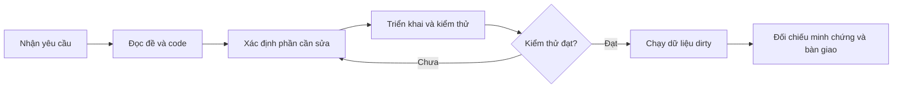
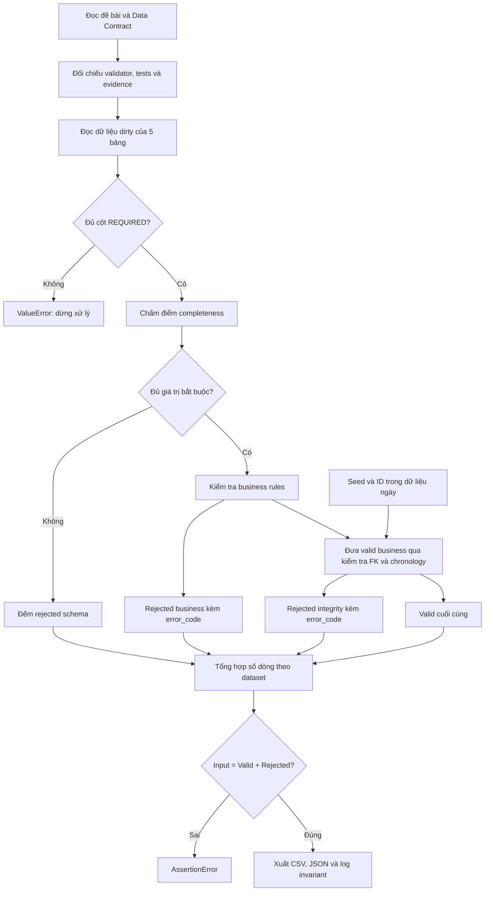

# Workflow AI — MD01-B7: Data Cleaning & Data Quality

Tài liệu mô tả luồng xử lý của cả 4 bài theo mã nguồn, kiểm thử và minh chứng trong repository; kèm kết quả xác minh ngày 20/10/2026. Đây là bản tổng hợp có thể tái hiện từ các hiện vật hiện có, không phải lịch sử đầy đủ các lần AI sửa code hoặc bản ghi prompt của các phiên trước.

- Đề bài: [MD01-B7](../../assignments/MD01-B7_Bai_tap_DATA_CLEANING_DATA_QUALITY.md).
- Quy định dữ liệu: [Data Contract](../data_contract.md).
- Đầu vào: `data/dirty/day_2026-07-02/`, gồm 5 bảng, tổng cộng 480 dòng.
- Đầu ra: điểm completeness, phân luồng valid/rejected trong bộ nhớ, mã lỗi, log minh chứng và báo cáo CSV/JSON.

## Quy trình AI thực hiện bài tập

Đây là quy trình có thể dùng lại khi giao B7 cho AI. Prompt bên dưới là mẫu đề xuất; các phần tiếp theo mô tả chi tiết mã nguồn và minh chứng hiện có.



| Bước | AI thực hiện | Đầu ra cần kiểm tra |
|---|---|---|
| 1. Đọc ngữ cảnh | Xác định một bài hay toàn bộ B7; đọc đề, Data Contract, validator, nơi gọi hàm và tests; kiểm tra git status | Danh sách yêu cầu, file liên quan và thay đổi có sẵn |
| 2. Đối chiếu | So sánh yêu cầu với hành vi hiện tại; xác định lỗi và ca biên | Phạm vi sửa cụ thể, tránh ghi đè phần đã đúng |
| 3. Triển khai | Sửa module tương ứng, giữ tương thích với report và pipeline | Code đáp ứng giao diện, mã lỗi và quy tắc theo đề |
| 4. Kiểm thử | Chạy tests liên quan; đọc lỗi, sửa và chạy lại khi cần | Kết quả thực chạy, gồm ca hợp lệ, vi phạm và biên |
| 5. Tạo minh chứng | Chạy module trên dữ liệu dirty; xuất đúng đường dẫn đề yêu cầu | Log và báo cáo khớp dữ liệu thực tế |
| 6. Bàn giao | Rà soát diff; nêu file sửa, kết quả tests, thống kê và giới hạn | Kết quả có thể tái hiện bằng lệnh ở phần 7 |

### Ví dụ áp dụng cho Bài 3

Code ban đầu đã có quy tắc FK và chronology. AI phát hiện cách gọi hai đối số chưa tự nạp tham chiếu, dẫn đến khóa hợp lệ bị đánh dấu sai. Phần sửa tự nạp khi tham số là `None`, giữ ý nghĩa của dict rỗng truyền tường minh, chuẩn hóa khóa và đưa thời gian về UTC.

AI thêm kiểm thử cho cả 5 quan hệ FK trong 4 nhóm bảng, nhiều lỗi trên một dòng, index trùng, dữ liệu rỗng, cách gọi hai đối số và thanh toán trước/bằng/sau đơn hàng có khác múi giờ. Lần xử lý Bài 3 trong phiên chat ghi nhận **60 tests đạt** khi chạy cùng schema, business và public validators. Kết quả **65 tests** ở phần 7 là kết quả đã ghi nhận trong tài liệu khi có thêm tests Bài 4, không phải lần chạy mới của lần bổ sung này.

### Prompt mẫu

> Thực hiện Bài 3 trong assignments/MD01-B7_Bai_tap_DATA_CLEANING_DATA_QUALITY.md. Đọc code và nơi gọi hàm trước khi sửa. Hoàn thiện yêu cầu, thêm kiểm thử cần thiết, chạy dữ liệu dirty và tạo docs/evidence/07-integrity.txt. Báo cáo kết quả thực chạy và các giới hạn còn lại.

### Tiêu chí hoàn thành

- Các quy tắc trong phạm vi yêu cầu đã được kiểm chứng; mỗi dòng chỉ thuộc valid hoặc rejected.
- Nhiều mã lỗi được nối bằng dấu `|` và không làm tăng số dòng rejected.
- Minh chứng nằm đúng đường dẫn và khớp kết quả thực chạy; Input = Valid + Rejected ở từng bảng.
- Phân biệt log chạy độc lập với báo cáo tuần tự để tránh cộng trùng reject.
- Không sửa dữ liệu nguồn để tạo lỗi minh chứng; dùng tests tổng hợp nếu dirty không có ca vi phạm.
- Chỉ báo tests đạt sau khi chạy thành công; ghi rõ các giới hạn về kiểu dữ liệu và FK chưa loại dây chuyền.

## 1. Workflow tổng thể



Quy trình làm việc để kiểm chứng lời giải: **đọc yêu cầu → đối chiếu code → kiểm tra ca biên bằng tests → đối chiếu dữ liệu dirty và evidence → ghi lại cách chạy**. Trong lần tạo tài liệu này, AI đọc các file liên quan, chạy lại 65 ca kiểm thử và tính lại thống kê từng tầng; không sửa validator hoặc tạo lại các log nghiệp vụ.

## 2. Bài 1 — Schema & Completeness Validation

**Mục tiêu:** phân biệt thiếu cột cấu trúc với thiếu giá trị trong một dòng, rồi chấm điểm completeness.

**Mã xử lý:** [schema_validator.py](../../src/validators/schema_validator.py).

### Các bước xử lý

1. `load_dataset(name)` đọc 4 file CSV và file `payments_daily.json`.
2. `validate_schema(name, df)` so sánh cột thực tế với `REQUIRED[name]`. Thiếu cột thì phát sinh `ValueError` chứa tên bảng và danh sách cột thiếu; các cột bổ sung được chấp nhận.
3. `score_rows(name, df)` kiểm tra cấu trúc trước, sau đó dùng `is_missing()` nhận diện `None`, `NaN`, `pd.NA`, `NaT`, chuỗi rỗng hoặc chỉ có khoảng trắng. Số `0` vẫn được coi là có giá trị.
4. Tính điểm và ghi chi tiết từng dòng:

   ```text
   score = round(100 × số trường bắt buộc có giá trị / tổng trường bắt buộc)
   output = row_id, score, errors, missing_cols
   ```

5. Nếu thiếu ít nhất một trường, `errors` chứa `MISSING_REQUIRED`; `missing_cols` liệt kê các trường thiếu.
6. Khi chạy module độc lập, `run()` ghi 10 dòng đầu mỗi bảng vào [07-schema.txt](../evidence/07-schema.txt).

### Danh sách trường được kiểm tra

`REQUIRED_VALUES` hiện sao chép danh sách `REQUIRED` cho từng bảng:

| Bảng | Trường bắt buộc |
|---|---|
| customers | customer_id, full_name, email, status |
| products | product_id, category_id, product_name, unit_price, status |
| orders | order_id, customer_id, order_date, status, order_total |
| order_items | order_item_id, order_id, product_id, quantity, unit_price, discount_amount |
| payments | payment_id, order_id, payment_date, payment_status, amount |

Data Contract không liệt kê đầy đủ ma trận này; danh sách trên phản ánh cấu hình trong code. Các cột audit không nằm trong phép chấm completeness hiện tại.

### Kết quả và kiểm thử

Các bảng dirty đều đủ cột. Dòng `CUS000004` thiếu `full_name`, đạt 75 điểm; 479 dòng còn lại đạt 100 điểm completeness.

```text
row_id=CUS000004 score=75 errors=[MISSING_REQUIRED]
  -> missing_cols=['full_name']
```

[test_schema_validator.py](../../tests/test_schema_validator.py) kiểm tra thiếu cột, các dạng missing, bảng rỗng, điểm 0, số 0 và làm tròn điểm. Điểm 100 ở bước này chỉ xác nhận có đủ giá trị bắt buộc; các điều kiện nghiệp vụ và khóa ngoại được kiểm tra ở bước sau.

Xem thêm [workflow chi tiết Bài 1](07-schema-completeness-workflow.md), được ghi từ lần xử lý trước.

## 3. Bài 2 — Business Rules Validation

**Mục tiêu:** tách dòng vi phạm quy tắc nghiệp vụ và giữ toàn bộ mã lỗi của mỗi dòng.

**Mã xử lý:** [business_validator.py](../../src/validators/business_validator.py).

### Các bước xử lý

1. Nhận DataFrame qua `split_valid_invalid(name, df)`. Trong báo cáo tổng hợp, đây là các dòng đã qua completeness; khi chạy module Bài 2 độc lập, đầu vào là toàn bộ dữ liệu dirty.
2. `_row_errors()` tạo danh sách lỗi riêng cho từng vị trí dòng và áp dụng các quy tắc:

| Nhóm | Điều kiện hợp lệ | Mã lỗi khi vi phạm |
|---|---|---|
| Email customers | Regex `r'^[^@\s]+@[^@\s]+\.[^@\s]+$'` | `INVALID_EMAIL` |
| Enum | status, channel, payment_method, payment_status thuộc danh sách theo bảng | `INVALID_<COL>` |
| Giá | unit_price ≥ 0 | `NEGATIVE_PRICE` |
| Số lượng | quantity > 0 | `INVALID_QUANTITY` |
| Tổng đơn | order_total ≥ 0 | `NEGATIVE_ORDER_TOTAL` |
| Thanh toán | amount ≥ 0 | `NEGATIVE_AMOUNT` |
| Giảm giá | discount_amount ≥ 0 | `NEGATIVE_DISCOUNT` |
| Consistency | discount_amount ≤ quantity × unit_price | `DISCOUNT_EXCEEDS_GROSS` |

3. Nối nhiều mã lỗi bằng `|`, ví dụ `INVALID_EMAIL|INVALID_STATUS`.
4. Trả về `(valid_df, rejected_df)`: valid không có cột `error_code`; rejected có cột này. Hàm sao chép DataFrame, giữ dữ liệu và index đầu vào.
5. `count_violations()` tách chuỗi mã lỗi để đếm số vi phạm theo rule. Một dòng có nhiều lỗi được tính vào nhiều rule, nhưng chỉ là một dòng rejected.
6. `run()` kiểm tra bảo toàn số dòng và ghi [07-business.txt](../evidence/07-business.txt).

### Kết quả và kiểm thử

Log độc lập ghi nhận 8 dòng rejected: customers 2, products 1, orders 1, order_items 2, payments 2. Tổng theo mã lỗi:

| Mã lỗi | Số vi phạm |
|---|---:|
| INVALID_STATUS | 2 |
| INVALID_EMAIL | 1 |
| NEGATIVE_PRICE | 1 |
| INVALID_QUANTITY | 1 |
| NEGATIVE_DISCOUNT | 1 |
| INVALID_PAYMENT_STATUS | 1 |
| NEGATIVE_AMOUNT | 1 |

[test_business_validator.py](../../tests/test_business_validator.py) kiểm tra email sai, enum, biên âm/0/dương, discount bằng hoặc vượt gross, nhiều lỗi cùng dòng, index trùng, dữ liệu rỗng và phép phân luồng trên dữ liệu dirty. Trường hợp discount vượt gross được tests bao phủ dù log dirty hiện không phát sinh mã này.

Xem [workflow chi tiết Bài 2](07-business-rules-workflow.md) để theo dõi các bước AI đã thực hiện, thay đổi cụ thể, cách xử lý môi trường Python và lệnh chạy lại.

## 4. Bài 3 — Cross-Table Integrity & Chronology

**Mục tiêu:** phát hiện orphan rows và thanh toán xảy ra trước thời điểm đặt hàng.

**Mã xử lý:** [integrity_validator.py](../../src/validators/integrity_validator.py).

### Các bước xử lý

1. `load_references()` nạp ID từ seed cho categories, customers, orders, products; gộp thêm ID customers, orders, products của ngày dirty.
2. `load_order_dates()` gộp ngày đặt hàng từ seed và dữ liệu ngày. Khi cùng `order_id`, giá trị dữ liệu ngày được đưa vào dict sau và ghi đè giá trị seed.
3. `split_cross_table_invalid(name, df, reference_ids, order_dates)` đối chiếu từng FK. Đề nhóm thành 4 nhóm theo bảng con; code có 5 quan hệ FK cụ thể:

| Quan hệ | Mã lỗi |
|---|---|
| products.category_id → categories.category_id | FK_CATEGORY_NOT_FOUND |
| orders.customer_id → customers.customer_id | FK_CUSTOMER_NOT_FOUND |
| order_items.order_id → orders.order_id | FK_ORDER_NOT_FOUND |
| order_items.product_id → products.product_id | FK_PRODUCT_NOT_FOUND |
| payments.order_id → orders.order_id | FK_ORDER_NOT_FOUND |

4. Với payments, parse hai mốc thời gian ISO 8601 về UTC rồi kiểm tra `payment_date >= order_date`. Thanh toán trước đơn hàng nhận `PAYMENT_BEFORE_ORDER`; bằng thời điểm đặt hàng vẫn hợp lệ.
5. Tách `(valid_df, rejected_df)`, nối nhiều mã lỗi bằng `|`, giữ thứ tự và index.
6. `run()` chạy độc lập trên dữ liệu dirty, kiểm tra số dòng và ghi chi tiết vào [07-integrity.txt](../evidence/07-integrity.txt).

### Kết quả và kiểm thử

| Bảng | Input độc lập | Valid | Rejected |
|---|---:|---:|---:|
| products | 30 | 29 | 1 |
| orders | 100 | 94 | 6 |
| order_items | 220 | 208 | 12 |
| payments | 90 | 87 | 3 |

Ví dụ minh chứng:

```text
products id=PRD000002 category_id=CAT999 NOT FOUND (FK_CATEGORY_NOT_FOUND)
order_items id=ITM00012721 order_id=ORD999999 NOT FOUND (FK_ORDER_NOT_FOUND)
```

Log dirty hiện không có `PAYMENT_BEFORE_ORDER`. [test_integrity_validator.py](../../tests/test_integrity_validator.py) kiểm tra riêng trường hợp thanh toán trước, bằng và sau thời điểm đặt hàng, bao gồm khác múi giờ; đồng thời kiểm tra cả 5 quan hệ FK, nhiều lỗi, index trùng, tham chiếu rỗng và cách gọi hàm chỉ với 2 đối số.

## 5. Bài 4 — Data Quality Report & Invariant Reconciliation

**Mục tiêu:** tổng hợp kết quả qua ba tầng và chứng minh không mất hoặc đếm thừa dòng trong quá trình phân luồng.

**Mã xử lý:** [quality_report.py](../../src/quality_report.py).

### Các bước xử lý

1. `collect_stats()` nạp bộ tham chiếu và ngày đặt hàng một lần.
2. Với từng bảng, nạp dirty, kiểm tra cấu trúc và chấm completeness.
3. Chuyển danh sách dòng đầy đủ thành mask theo vị trí; dùng `iloc` để xử lý đúng cả khi index trùng. Dòng thiếu giá trị được tính vào `rejected_schema`.
4. Chỉ đưa dòng đủ giá trị sang business; chỉ đưa dòng business hợp lệ sang integrity.
5. Tính kết quả cuối:

   ```text
   valid = số dòng còn lại sau integrity
   rejected = rejected_schema + rejected_business + rejected_integrity
   assert input == valid + rejected
   ```

6. `build_report()` kiểm tra lại invariant từng dataset và tổng thể trước khi xuất CSV/JSON. Nếu hai dataset lệch ngược chiều khiến tổng vẫn cân bằng, assert từng dataset vẫn phát hiện lỗi.
7. `run()` ghi log xác nhận invariant cho từng bảng và tổng cộng.

### Kết quả đã tính lại khi tạo workflow

| Dataset | Input | Reject schema | Reject business | Reject integrity | Valid cuối | Rejected tổng |
|---|---:|---:|---:|---:|---:|---:|
| customers | 40 | 1 | 2 | 0 | 37 | 3 |
| products | 30 | 0 | 1 | 1 | 28 | 2 |
| orders | 100 | 0 | 1 | 6 | 93 | 7 |
| order_items | 220 | 0 | 2 | 12 | 206 | 14 |
| payments | 90 | 0 | 2 | 2 | 86 | 4 |
| **Tổng** | **480** | **1** | **8** | **21** | **450** | **30** |

```text
customers: 40 = 37 + 3 OK
products: 30 = 28 + 2 OK
orders: 100 = 93 + 7 OK
order_items: 220 = 206 + 14 OK
payments: 90 = 86 + 4 OK
TOTAL: 480 = 450 + 30 OK
```

Các số này khớp với [CSV report](../../reports/data_quality_report.csv) và [log invariant](../evidence/07-invariant.txt) hiện có. [JSON summary](../../reports/data_quality_summary.json) chứa run_id, data_dir, generated_at, invariant, invariant_ok, tổng số dòng và chi tiết từng bảng.

[test_quality_report.py](../../tests/test_quality_report.py) kiểm tra CSV/JSON khớp nhau, iterator đầu vào, báo cáo rỗng, invariant từng bảng dù tổng cân bằng, index trùng, không đếm lại dòng đã loại và ghi log invariant.

## 6. Cách hiểu kết quả và phạm vi hiện tại

- **Log độc lập và báo cáo tuần tự có đầu vào khác nhau.** Không cộng trực tiếp số reject trong ba log độc lập để tạo báo cáo. Ví dụ payments có 3 reject integrity khi chạy độc lập, nhưng chỉ 2 reject integrity sau tầng business vì một dòng vi phạm đã bị loại trước đó.
- **Tham chiếu FK gồm seed và ID ngày chưa lọc.** Một ID cha có mặt trong dirty vẫn được dùng để đối chiếu dù dòng cha bị reject. Workflow hiện tại chưa thực hiện loại dây chuyền bảng con theo tập cha valid cuối cùng.
- **Completeness chưa kiểm tra kiểu dữ liệu.** Business dùng `to_numeric(errors='coerce')` rồi bỏ qua NaN; integrity bỏ qua ngày không parse được. Chuỗi số/ngày sai định dạng nhưng không rỗng chưa có rule riêng để bị reject trong pipeline báo cáo hiện tại.
- **Một số cột enum chưa thuộc REQUIRED.** `channel` và `payment_method` được kiểm tra enum khi có cột và có giá trị; thiếu chúng không gây lỗi cấu trúc theo danh sách hiện tại.
- **Các luồng valid/rejected tồn tại trong bộ nhớ.** Các module B7 ghi log và báo cáo tổng hợp; chưa xuất toàn bộ bản ghi valid/rejected thành file riêng. Riêng reject completeness trong `collect_stats()` chỉ được đếm, không được tích lũy thành DataFrame reject có `error_code`.
- **Invariant xác nhận bảo toàn số dòng.** Nó không chứng minh mọi quy tắc chất lượng hoặc mọi quan hệ nghiệp vụ đều đã được bao phủ. Chạy Python bình thường để các lệnh `assert` hoạt động; chế độ `-O` vô hiệu hóa assert.

## 7. Chạy lại và xác minh

Chạy tại thư mục gốc repository trong PowerShell. Các lệnh dùng bản Python và dependency cục bộ đã được dùng để xác minh tài liệu:

```powershell
$dqPython = 'C:/Users/MSI/AppData/Local/Programs/Python/Python311/python.exe'
$env:PYTHONPATH = (Join-Path (Get-Location) '.test-deps')
$env:PYTHONIOENCODING = 'utf-8'

# Kiểm thử liên quan đến cả 4 bài
& $dqPython -m pytest tests/test_schema_validator.py tests/test_business_validator.py tests/test_integrity_validator.py tests/test_quality_report.py tests/test_validators_public.py -q

# Tái tạo minh chứng từng bài; các lệnh này ghi lại log/báo cáo tương ứng
& $dqPython -m src.validators.schema_validator
& $dqPython -m src.validators.business_validator
& $dqPython -m src.validators.integrity_validator
& $dqPython -m src.quality_report
```

Nếu dùng môi trường Python khác, thay `$dqPython` và dùng pandas/pytest đã cài trong môi trường đó; không cần đặt `.test-deps` vào `PYTHONPATH`.

**Kết quả kiểm thử thực chạy khi tạo tài liệu: `65 passed in 3.09s`.** AI tính lại số dòng từng tầng bằng các hàm validator và `collect_stats()`, không ghi đè evidence hoặc báo cáo. Bộ kiểm thử này tập trung vào B7, không phải toàn bộ bài kiểm thử của dự án.

## 8. Đối chiếu đầu ra nộp bài

| Bài | Mã nguồn | Minh chứng |
|---|---|---|
| 1 — Schema | [schema_validator.py](../../src/validators/schema_validator.py) | [07-schema.txt](../evidence/07-schema.txt) |
| 2 — Business | [business_validator.py](../../src/validators/business_validator.py) | [07-business.txt](../evidence/07-business.txt) |
| 3 — Integrity | [integrity_validator.py](../../src/validators/integrity_validator.py) | [07-integrity.txt](../evidence/07-integrity.txt) |
| 4 — Report | [quality_report.py](../../src/quality_report.py) | [CSV](../../reports/data_quality_report.csv), [JSON](../../reports/data_quality_summary.json), [07-invariant.txt](../evidence/07-invariant.txt) |
