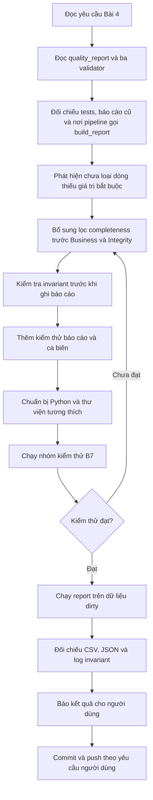

# Workflow AI — Bài 4: Data Quality Report & Invariant Reconciliation

Tài liệu ghi lại quy trình AI đã thực hiện Bài 4 trong [đề MD01-B7](../../assignments/MD01-B7_Bai_tap_DATA_CLEANING_DATA_QUALITY.md), từ kiểm tra mã hiện có đến kiểm thử, tạo minh chứng và đưa thay đổi lên `main`.

## 1. Yêu cầu và tiêu chí hoàn thành

| Yêu cầu | Tiêu chí xác nhận |
|---|---|
| Tổng hợp chất lượng dữ liệu | Có `dataset`, `input`, `valid`, `rejected` cho cả 5 bảng |
| Xuất báo cáo | Có CSV và JSON trong `reports/` |
| Bảo toàn số dòng | `assert input == valid + rejected` qua với từng dataset và tổng |
| Minh chứng | Có log `docs/evidence/07-invariant.txt` từ lần chạy thực tế |

Đầu vào là `data/dirty/day_2026-07-02/`. Phạm vi triển khai là [quality_report.py](../../src/quality_report.py), tái sử dụng ba validator đã có.

## 2. Luồng làm việc của AI



### Bước 1 — Đọc và đối chiếu hiện trạng

AI đọc đề bài, `src/quality_report.py`, các validator và tests liên quan; kiểm tra báo cáo hiện có cùng cách `src/pipeline.py` gọi `build_report()`.

Mã report đã tồn tại và có assert. Tuy nhiên, `collect_stats()` mới gọi `validate_schema()` để kiểm tra đủ cột, rồi chuyển toàn bộ dữ liệu sang Business. Business và Integrity bỏ qua một số giá trị thiếu vì chúng thuộc trách nhiệm tầng Schema. Vì vậy, dòng thiếu `full_name` vẫn có thể được tính là valid dù invariant về số dòng vẫn đúng.

### Bước 2 — Hoàn thiện phân luồng và thống kê

AI bổ sung gọi `score_rows()` rồi dùng danh sách lỗi completeness để tạo mask boolean theo vị trí:

```python
scores = schema_validator.score_rows(name, df)
complete = scores['errors'].map(lambda errors: not errors).to_numpy(dtype=bool)
schema_valid = df.iloc[complete]
rejected_schema = int((~complete).sum())
```

`iloc` giúp xử lý đúng khi index trùng. Mask có kiểu `bool` rõ ràng để dùng được cả với DataFrame rỗng.

Luồng dữ liệu được thực hiện tuần tự:

```text
Input
  → Schema: tách dòng thiếu giá trị bắt buộc
  → Business: chỉ nhận dòng qua Schema
  → Integrity: chỉ nhận dòng qua Business
  → Valid cuối cùng

Rejected = rejected_schema + rejected_business + rejected_integrity
Input = Valid + Rejected
```

Mỗi dòng chỉ đi vào một nhóm rejected, dù có nhiều lỗi hoặc vi phạm nhiều tầng. Không cộng số reject từ các lần chạy validator độc lập vì có thể đếm lại cùng một dòng.

### Bước 3 — Hoàn thiện việc xuất báo cáo

Trong `build_report()`, AI chuyển `stats` thành list một lần để hỗ trợ iterator và dùng lại dữ liệu cho DataFrame, assert và JSON. AI cũng chuyển việc ghi CSV xuống sau khi kiểm tra invariant từng dataset và tổng thể.

Giữ nguyên giao diện `build_report(stats, run_id=None, out_dir='reports')` và giá trị trả về `(df, csv_file, json_file)` để tương thích với pipeline hiện có.

### Bước 4 — Bổ sung kiểm thử có mục đích

AI tạo [test_quality_report.py](../../tests/test_quality_report.py) với 5 ca:

| Ca kiểm thử | Điều cần chứng minh |
|---|---|
| Xuất CSV/JSON từ iterator | Hai định dạng khớp dữ liệu, tổng và `run_id` đúng |
| Hai dataset lệch ngược chiều | Assert từng dataset phát hiện lỗi dù tổng cân bằng; chưa ghi file report |
| Báo cáo rỗng | CSV vẫn có header và tổng JSON bằng 0 |
| Completeness, nhiều lỗi, index trùng | Dòng chỉ thiếu giá trị bị loại; dòng vi phạm nhiều tầng không bị đếm lại |
| Chạy `run()` | Ghi log invariant từng bảng, tổng và trạng thái PASS |

### Bước 5 — Xử lý môi trường và chạy xác nhận

Trong phiên triển khai, lệnh `python` không có trên PATH và `py` không tìm thấy bản Python đã đăng ký. Python đi kèm pgAdmin là 3.13, còn thư viện trong `.test-deps` được biên dịch cho 3.11 nên không tương thích.

AI tìm được Python 3.12 trong runtime cục bộ, cài pandas/pytest và dependency vào `.test-deps312/`, rồi thêm thư mục này vào `.gitignore`. Các thư viện này không được đưa vào commit.

Lệnh kiểm thử đã dùng tại thư mục gốc repository:

```powershell
$dqPython = 'C:/Users/MSI/.cache/codex-runtimes/codex-primary-runtime/dependencies/python/python.exe'
& $dqPython -c "import sys; sys.path[:0]=[r'$PWD/.test-deps312',r'$PWD']; import pytest; sys.exit(pytest.main(['tests/test_quality_report.py','tests/test_schema_validator.py','tests/test_business_validator.py','tests/test_integrity_validator.py','tests/test_validators_public.py','-q']))"
```

Kết quả thực tế: **65 passed in 18.42s**. Đây là nhóm kiểm thử B7 liên quan, chưa phải toàn bộ test suite của repository.

Sau đó AI chạy báo cáo thực tế:

```powershell
& $dqPython -c "import sys; sys.path[:0]=[r'$PWD/.test-deps312',r'$PWD']; from src.quality_report import run; run()"
git diff --check
```

Các đường dẫn runtime trên phản ánh môi trường của phiên triển khai. Với môi trường đã cài dependency từ `requirements.txt`, có thể chạy bằng `python -m pytest` với cùng danh sách test và `python -m src.quality_report`.

## 3. Kết quả và minh chứng

| Dataset | Input | Valid | Rejected |
|---|---:|---:|---:|
| customers | 40 | 37 | 3 |
| products | 30 | 28 | 2 |
| orders | 100 | 93 | 7 |
| order_items | 220 | 206 | 14 |
| payments | 90 | 86 | 4 |
| **Tổng** | **480** | **450** | **30** |

So với báo cáo cũ, một dòng customers thiếu giá trị bắt buộc được chuyển từ valid sang rejected: tổng thay đổi từ `451 valid / 29 rejected` thành `450 valid / 30 rejected`.

Các đầu ra đã được tạo bằng lần chạy thực tế:

- [data_quality_report.csv](../../reports/data_quality_report.csv): số dòng từng dataset.
- [data_quality_summary.json](../../reports/data_quality_summary.json): metadata lần chạy, tổng và chi tiết.
- [07-invariant.txt](../evidence/07-invariant.txt): xác nhận `480 = 450 + 30` và assert PASS.

Sau yêu cầu commit/push của người dùng, AI tạo commit `962c650` — `Complete data quality report and invariant reconciliation`, rồi push thành công lên `origin/main` sau khi người dùng xác nhận đích và nội dung push.

## 4. Phạm vi của kết quả

Invariant xác nhận bảo toàn **số dòng**, không tự chứng minh đã bao phủ mọi quy tắc chất lượng. Bộ tham chiếu FK hiện vẫn dùng seed cộng ID trong dữ liệu ngày theo validator sẵn có. Phần report chỉ đếm reject completeness, chưa xuất các dòng này thành file rejected riêng. Python cần chạy ở chế độ thông thường vì `-O` vô hiệu hóa `assert`.

Xem [workflow tổng thể MD01-B7](07-data-cleaning-data-quality-workflow.md) để đối chiếu cả bốn bài.
