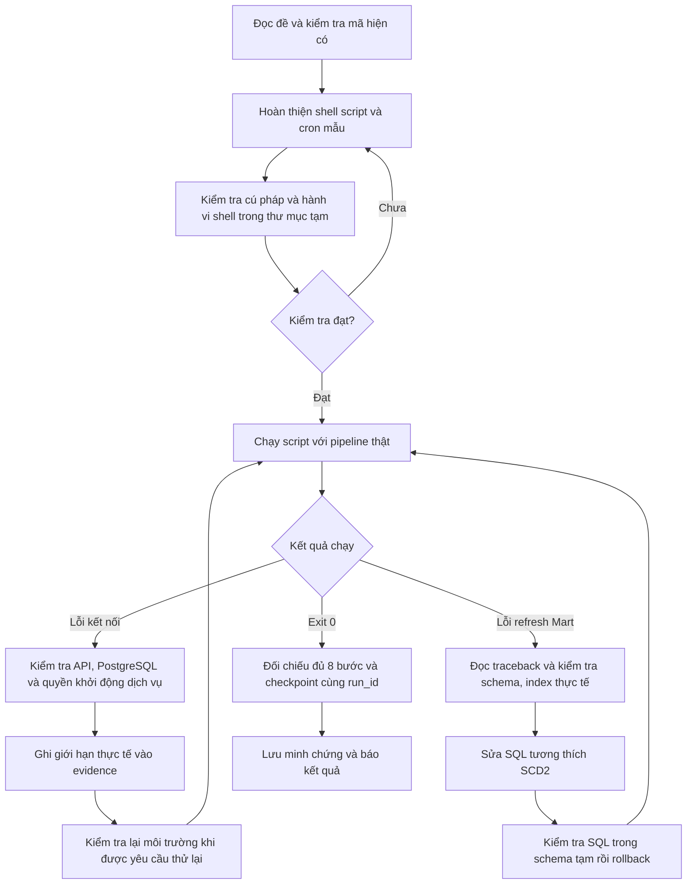

# Workflow AI — Bài 5: Automation Script & Cron Scheduling

Tài liệu mô tả cách AI xử lý Bài 5 trong [đề MD01-B8](../../assignments/MD01-B8_Bai-tap_Tu-dong-hoa-Daily-Pipeline-va-Tich-hop-End-to-End.md): đọc yêu cầu, khảo sát mã, hoàn thiện shell script, kiểm tra độc lập, chẩn đoán lỗi môi trường và database, chạy lại rồi lưu minh chứng. Các kết quả dưới đây thuộc phiên thực hiện ngày **20/10/2026**, theo giờ Việt Nam.

## 1. Chuyển yêu cầu thành tiêu chí kiểm chứng

AI tách đề bài thành các điều kiện có thể quan sát được trước khi sửa mã:

| Yêu cầu | Cách kiểm chứng |
|---|---|
| Dừng khi lỗi, biến chưa gán hoặc lỗi trong pipe | Có `set -euo pipefail`; kiểm tra cú pháp Bash |
| Xác định thư mục gốc theo vị trí script | Có `ROOT="$(cd "$(dirname "$0")/.." && pwd)"`; thử chạy từ thư mục khác |
| Kích hoạt `.venv` | Chọn `.venv/bin/activate` trên Linux hoặc `.venv/Scripts/activate` trên Git Bash |
| Chạy đúng pipeline | Truyền `--source both`, batch `day_2026-07-01` và `--refresh-mart` |
| Ghi toàn bộ output theo ngày | Có `logs/pipeline_YYYYMMDD.log`, chứa cả stdout và stderr |
| Bảo toàn log khi chạy lại | Dùng append `>>`, kiểm tra hai lần chạy cùng ngày |
| Trả đúng exit code của Python | Giả lập Python trả 0 và 7; shell phải trả đúng 0 và 7 |
| Có quyền thực thi | Chạy `chmod +x`, kiểm tra `test -x`; Git ghi mode `100755` |
| Cron chạy lúc 02:00 | Dòng cron có `0 2 * * *`, script và log đều dùng đường dẫn tuyệt đối |
| Có minh chứng thật | Chạy script với pipeline thật, ghi log và exit code vào `08-daily.txt` |

**Prompt có thể dùng lại:**

> Đọc riêng Bài 5 của MD01-B8. Đối chiếu từng yêu cầu với scripts/run_daily.sh và scripts/cron_example.txt. Kiểm tra môi trường hiện tại, Git diff, cấu trúc .venv và các dịch vụ phụ thuộc. Hoàn thiện phần còn thiếu, kiểm tra mã thoát và log, sau đó chạy pipeline thật để tạo minh chứng. Phân biệt rõ kiểm tra giả lập với kết quả end-to-end.

## 2. Luồng ra quyết định của AI



## 3. Khảo sát trước khi sửa

AI đọc script hiện có, cron mẫu và các module cấu hình, điều phối, refresh. Các file chính gồm:

- [run_daily.sh](../../scripts/run_daily.sh), [cron_example.txt](../../scripts/cron_example.txt): điểm thực thi của Bài 5.
- [pipeline.py](../../src/pipeline.py): CLI, tám bước xử lý và mã thoát.
- [config.py](../../src/config.py), [database.py](../../src/database.py): cấu hình kết nối và đường dẫn.
- [refresh_mart.py](../../src/refresh_mart.py), [SQL refresh](../../sql/solutions/12_load_data_mart.sql): bước phụ thuộc khi bật `--refresh-mart`.
- [README](../../README.md), [docker-compose.yml](../../docker-compose.yml): cách chạy môi trường và dịch vụ.

Script ban đầu đã có strict mode, xác định ROOT và lệnh chạy pipeline. Hai khoảng trống chính là **chưa ghi log theo ngày** và **chỉ kích hoạt virtual environment theo cấu trúc Linux**, trong khi máy đang dùng Windows. Cron ban đầu đã có biểu thức 02:00 nhưng cần hướng dẫn rõ việc thay đường dẫn và chuẩn bị môi trường.

AI kiểm tra trạng thái Git để nhận biết thay đổi có sẵn. Việc đọc repository giúp giới hạn sửa đổi vào phần cần thiết, tránh viết lại logic ETL đã có.

## 4. Hoàn thiện script và cấu hình cron

### 4.1. Đường dẫn, môi trường và log

AI giữ cách tính ROOT theo đề, sau đó `cd "$ROOT"` để các đường dẫn tương đối trong lệnh Python hoạt động khi script được gọi từ cron hoặc thư mục khác.

Sau khi tạo thư mục `logs`, script chuyển output của toàn bộ phần chạy tiếp theo vào log ngày:

```bash
mkdir -p "$ROOT/logs"
exec >> "$ROOT/logs/pipeline_$(date +%Y%m%d).log" 2>&1
```

`>>` giữ lại log những lần chạy trước trong ngày. `2>&1` đưa stderr về cùng nơi với stdout. Vì chuyển hướng được đặt trước phần kích hoạt `.venv`, lỗi thiếu môi trường ảo cũng được ghi vào log.

Script lần lượt kiểm tra `.venv/bin/activate` và `.venv/Scripts/activate`. Nếu không có cả hai, script ghi lỗi và trả 1. Các đường dẫn được đặt trong dấu nháy kép để xử lý thư mục có khoảng trắng.

### 4.2. Giữ nguyên mã thoát

Lệnh cuối dùng `exec` để thay tiến trình shell bằng Python:

```bash
exec python -m src.pipeline --source both --input-dir data/incremental/day_2026-07-01 --refresh-mart
```

Nhờ đó, tiến trình gọi script nhận trực tiếp mã thoát của Python. AI không thêm một lệnh thành công ở cuối làm che mã lỗi của pipeline.

AI chạy `chmod +x scripts/run_daily.sh` và ghi executable bit vào Git index để file có mode `100755`. [.gitattributes](../../.gitattributes) quy định LF cho script và cron mẫu, tránh Git chuyển chúng sang CRLF trên Windows.

### 4.3. Chuẩn bị cron mẫu

[cron_example.txt](../../scripts/cron_example.txt) khai báo `SHELL`, `PATH` và lịch `0 2 * * *`. Hai đường dẫn tuyệt đối trong ví dụ cần được thay bằng đường dẫn triển khai thực tế.

AI ghi rõ 02:00 được hiểu theo múi giờ máy chạy cron. Người vận hành cần tạo `.venv` trên hệ điều hành đó, chuẩn bị thư mục log và bảo đảm API/PostgreSQL sẵn sàng. File `cron.log` nhận lỗi khởi chạy; output của pipeline được script ghi vào log ngày.

Trong phiên này, AI chỉ chuẩn bị cấu hình mẫu, **không cài crontab hệ thống**.

## 5. Kiểm tra hành vi shell trước khi chạy ETL

AI dùng thư mục tạm có tên chứa khoảng trắng, sao chép script vào đó và tạo executable Python giả. Cách này kiểm tra lớp shell mà không cần kết nối database.

| Kiểm tra | Kết quả |
|---|---|
| `bash -n scripts/run_daily.sh` | Đạt |
| `chmod +x` và `test -x` | Đạt |
| Python giả trả 0 | Shell trả 0 |
| Python giả trả 7 | Shell trả 7 |
| Gọi từ thư mục khác với ROOT có khoảng trắng | Chuyển về ROOT đúng |
| Hai lần chạy cùng ngày | Cùng một file log, nội dung được append |
| Python giả ghi stdout và stderr | Cả hai xuất hiện trong log |
| Tham số gọi Python | Khớp lệnh trong đề bài |

Các kiểm tra này xác nhận đường dẫn, chuyển hướng và exit code. Chúng chưa chứng minh các bước ETL hoặc refresh database chạy thành công.

**Prompt có thể dùng lại:**

> Kiểm tra run_daily.sh trong thư mục tạm, có khoảng trắng trong đường dẫn và được gọi từ thư mục khác. Dùng executable Python giả để xác nhận mã thoát 0 và một mã lỗi khác 0 được giữ nguyên. Kiểm tra đủ tham số, cả stdout/stderr, tên log ngày và append khi chạy lại. Ghi rõ đây là kiểm tra wrapper, không gọi đó là thành công end-to-end.

## 6. Chạy thật, phân loại lỗi và sửa nguyên nhân

### 6.1. Lần đầu: dịch vụ chưa sẵn sàng

Script tạo log ngày và bắt đầu trích xuất, nhưng Mock API tại `localhost:8000` không kết nối được. Sau ba lần thử, Python trả 1; checkpoint được kiểm tra và giữ nguyên theo byte.

AI kiểm tra thêm môi trường: PostgreSQL service đang dừng, Docker daemon chưa chạy, và thao tác `Start-Service` không khởi động được PostgreSQL do không mở được service với quyền hiện tại. AI lưu các giới hạn này vào evidence và báo chưa có kết quả chạy thật thành công.

### 6.2. Khi người dùng yêu cầu thử lại: kiểm tra kết nối thực tế

AI kiểm tra lại hai cổng 5432 và 8000; cả hai đã mở. Dù Windows PostgreSQL service vẫn báo dừng, kết nối database thực tế đã hoạt động. Vì vậy, AI tiếp tục chạy script dựa trên kết quả kết nối, không suy luận chỉ từ trạng thái một service.

Lần chạy tiếp theo hoàn tất trích xuất, chuẩn hóa, kiểm định, upsert Core và báo cáo, rồi lỗi ở bước `[7/8]`:

```text
psycopg.errors.InvalidColumnReference:
there is no unique or exclusion constraint matching the ON CONFLICT specification
```

AI đọc traceback, kiểm tra index và cột thực tế của `mart.dim_product`, rồi đối chiếu [bài bonus SCD2](../../sql/student/04_bonus_scd.sql). Database đã dùng khóa `(product_id, valid_from)` và unique index có điều kiện `WHERE is_current`. Trong khi đó, SQL refresh dùng `ON CONFLICT (product_id)` dành cho dimension Type 1. `CREATE TABLE IF NOT EXISTS` không thay đổi cấu trúc bảng đã tồn tại nên không giải quyết được khác biệt này.

### 6.3. Sửa SQL tương thích cấu trúc đang có

AI sửa [12_load_data_mart.sql](../../sql/solutions/12_load_data_mart.sql) để phân nhánh theo sự tồn tại của cột `is_current`:

- Với Type 1: giữ upsert theo `product_id`.
- Với SCD2: đóng phiên bản khi thuộc tính theo dõi thay đổi ở ngày mới, mở phiên bản thay thế và cập nhật phiên bản hiện hành. Thay đổi trong cùng ngày cập nhật phiên bản của ngày đó để tránh khoảng hiệu lực không hợp lệ.
- Khi nạp fact: tra phiên bản sản phẩm theo ngày đơn hàng và khoảng `valid_from`–`valid_to`; schema Type 1 dùng khoảng ngày mặc định.

AI giữ cấu trúc SCD2 đã có trong database, không khôi phục unique constraint Type 1 lên `product_id`.

Trước khi chạy lại pipeline, AI thực thi SQL với Core thật và một schema kiểm tra riêng trong transaction, rồi rollback toàn bộ schema kiểm tra. Các ca đạt gồm Type 1 nạp/replay; SCD2 tạo phiên bản, giữ lịch sử, replay và sửa trong cùng ngày. Bộ kiểm thử `tests/test_refresh_mart.py` cũng đạt **4 tests**.

**Prompt có thể dùng lại:**

> Khi script lỗi, tìm bước thất bại từ log rồi kiểm tra nguyên nhân tại module phụ thuộc. Với lỗi ON CONFLICT, đọc index/constraint thực tế và đối chiếu DDL trong repository. Sửa tương thích với schema hiện có, kiểm tra trong schema tạm có rollback, sau đó chạy lại script thật. Không xóa schema hoặc thay đổi checkpoint để ép lần chạy thành công.

## 7. Đối chiếu kết quả và lưu minh chứng

Sau sửa SQL, script chạy thành công lúc **18:52 ngày 20/10/2026**, với:

```text
run_id=d51204ca-d651-4e4c-89ef-0f14121a3c84
source=both
exit_code=0
```

AI xác nhận log có đủ `[1/8]` đến `[8/8]`, Mart refresh đã commit, checkpoint có `status=success`, `last_source=both` và `last_run_id` khớp log. Minh chứng được bổ sung theo từng lần chạy để giữ cả lỗi ban đầu và lần khắc phục thành công.

| Dataset | Input | Valid | Reject | Inserted | Updated |
|---|---:|---:|---:|---:|---:|
| customers | 100 | 100 | 0 | 0 | 100 |
| products | 50 | 50 | 0 | 0 | 50 |
| orders | 0 | 0 | 0 | 0 | 0 |
| order_items | 0 | 0 | 0 | 0 | 0 |
| payments | 0 | 0 | 0 | 0 | 0 |

API không trả giao dịch mới vì các watermark hiện có đã cập nhật đến dữ liệu nguồn. Đây là lần chạy thành công với checkpoint hiện tại; kết quả này không phải minh chứng nạp thêm một batch giao dịch mới. Mart giữ 14.250 fact, 5.600 đơn hàng; các KPI không đổi sau lần chạy này.

| Kết quả bàn giao | Đường dẫn |
|---|---|
| Shell script | [scripts/run_daily.sh](../../scripts/run_daily.sh) |
| Cấu hình cron mẫu | [scripts/cron_example.txt](../../scripts/cron_example.txt) |
| Quy tắc line ending | [.gitattributes](../../.gitattributes) |
| SQL refresh tương thích SCD2 | [12_load_data_mart.sql](../../sql/solutions/12_load_data_mart.sql) |
| Minh chứng kiểm tra và các lần chạy | [08-daily.txt](../evidence/08-daily.txt) |
| Log ngày của phiên thực hiện | [pipeline_20261020.log](../../logs/pipeline_20261020.log) |
| Checkpoint | [pipeline_state.json](../../metadata/pipeline_state.json) |

Checkpoint, log, báo cáo chất lượng và KPI là output có thể thay đổi ở các lần chạy sau. Khi tái hiện, đối chiếu theo `run_id` mới và mã thoát thực tế.

## 8. Lệnh tái hiện

Trong Git Bash tại thư mục gốc dự án, khi `.venv`, PostgreSQL và Mock API đã sẵn sàng:

```bash
bash -n scripts/run_daily.sh
chmod +x scripts/run_daily.sh
./scripts/run_daily.sh
daily_exit=$?
printf 'exit_code=%s\n' "$daily_exit"
tail -n 30 "logs/pipeline_$(date +%Y%m%d).log"
```

Để kiểm tra module refresh từ PowerShell:

```powershell
& .venv/Scripts/python.exe -m pytest tests/test_refresh_mart.py -q
```

Chạy script sẽ upsert Core, refresh Mart và cập nhật checkpoint khi thành công. Sau khi kiểm chứng trên máy Linux/WSL triển khai thực tế, thay đường dẫn trong cron mẫu rồi dùng `crontab -e` nếu muốn bật lịch. Phiên thực hiện được ghi lại ở đây chưa kiểm chứng một lần kích hoạt tự động từ cron daemon.
