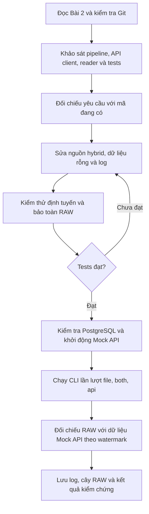

# Workflow AI — Bài 2: Multi-Source Ingestion & RAW Capture

Tài liệu ghi lại cách AI xử lý [Bài 2 của MD01-B8](../../assignments/MD01-B8_Bai-tap_Tu-dong-hoa-Daily-Pipeline-va-Tich-hop-End-to-End.md) ngày 20/10/2026: khảo sát mã, sửa định tuyến nguồn, kiểm thử và tạo minh chứng bằng API cùng PostgreSQL thật.

## 1. Yêu cầu và tiêu chí hoàn thành

| Chế độ/yêu cầu | Hành vi cần xác nhận |
|---|---|
| `file` | Đọc `customers_daily.csv`, `products_daily.csv`, `orders_daily.csv`, `order_items_daily.csv`, `payments_daily.json` trong `--input-dir` |
| `api` | Gọi `fetch_all_pages()` cho cả 5 dataset; truyền `updated_after` riêng theo watermark của mỗi dataset |
| `both` | Đọc customers/products từ file; lấy orders/order_items/payments từ API; không phụ thuộc các file giao dịch |
| RAW | Lưu bản ghi API trước khi tạo DataFrame tại `data/raw/<run_id>/<dataset>.json` |
| Bảo toàn dữ liệu | Giữ nguyên giá trị bản ghi và không ghi đè snapshot đã tồn tại |
| Truy vết | Log có nguồn, dataset, số dòng và `run_id`; mỗi lần chạy dùng UUID riêng |
| Dữ liệu gia tăng rỗng | Vẫn lưu snapshot rỗng và cho phép pipeline hoàn thành |

Mã chính: [src/pipeline.py](../../src/pipeline.py). AI tái sử dụng [api_client.py](../../src/api_client.py), [extract_files.py](../../src/extract_files.py) và luồng điều phối Bài 1.

## 2. Luồng xử lý của AI



### Bước 1 — Khảo sát hiện trạng

AI đọc đề, kiểm tra trạng thái Git, sau đó đọc `src/pipeline.py`, API client, file reader, cấu hình, schema validator, Mock API và các test liên quan. AI kiểm tra cơ chế upsert để xác định tác động của việc chạy pipeline thật.

Các chức năng đã có gồm phân trang, ánh xạ `order_items` sang endpoint `/order-items`, đọc watermark theo dataset, lưu RAW bằng chế độ mở file `x` và sinh UUID cho phiên chạy. AI giữ lại các chức năng này.

Những điểm cần sửa:

- Nhánh `both` đọc cả 5 file trước khi thay 3 dataset giao dịch bằng API. Vì vậy, thiếu một file giao dịch vẫn làm hybrid thất bại.
- File reader từ chối dataset rỗng. API gia tăng không có bản ghi mới vì thế có thể làm pipeline lỗi dù yêu cầu HTTP thành công.
- Log trích xuất cần thể hiện rõ nguồn thực tế của từng dataset và mã phiên chạy.
- Nhánh cập nhật state của `both` có thể lấy timestamp từ file danh mục để cập nhật watermark API của danh mục, dù lần chạy đó không gọi API danh mục.

**Prompt có thể dùng lại:**

> Đọc Bài 2 của MD01-B8 và các hàm _source_frames, _file_frames, _api_frames. Kiểm tra Git trước khi sửa. Đối chiếu ba chế độ nguồn với mã hiện có; xác định cách phân trang, truyền watermark và lưu RAW. Chú ý hybrid thiếu file giao dịch và API trả danh sách rỗng.

### Bước 2 — Hoàn thiện định tuyến nguồn

AI thêm hai nhóm `MASTER_RESOURCES` và `TRANSACTION_RESOURCES`. `_file_frames()` nhận danh sách dataset cần đọc; mặc định vẫn đọc đủ 5 dataset.

| Dataset | `file` | `api` | `both` |
|---|---|---|---|
| customers | File | API `/customers` | File |
| products | File | API `/products` | File |
| orders | File | API `/orders` | API `/orders` |
| order_items | File | API `/order-items` | API `/order-items` |
| payments | File | API `/payments` | API `/payments` |

`_source_frames()` gọi đúng nhóm nguồn rồi ghi log `source`, `dataset`, `rows`, `run_id` cho từng DataFrame. Trong `both`, chỉ các dataset giao dịch được xét cập nhật watermark API.

### Bước 3 — Giữ RAW trước khi tạo DataFrame

Với mỗi dataset API, `_api_frames()` thực hiện theo thứ tự:

1. Đọc `state['api_watermarks']` để lấy mốc riêng của dataset.
2. Gọi `fetch_all_pages(name, updated_after=watermark, page_size=100)`.
3. Gọi `save_raw()` để ghi toàn bộ danh sách bản ghi trả về.
4. Đọc snapshot thành DataFrame nếu có bản ghi. Nếu danh sách rỗng, tạo DataFrame rỗng với các cột bắt buộc của schema validator.

Snapshot gồm `resource`, `run_id`, `fetched_at`, `updated_after`, `total` và `data`. Các bản ghi trong `data` giữ nguyên khoảng trắng, chuỗi số, Unicode, null và cấu trúc lồng nhau trước chuẩn hóa. Đây là snapshot danh sách bản ghi đã gom từ các trang; không lưu nguyên văn HTTP response hay metadata của từng trang.

`save_raw()` dùng `open('x')`: trùng đường dẫn sẽ phát sinh `FileExistsError` thay vì ghi đè. Mỗi UUID tạo một thư mục riêng. Log lưu RAW được bổ sung `run_id` để nối với log điều phối.

**Prompt có thể dùng lại:**

> Sửa hybrid để chỉ đọc hai file master và lấy ba dataset giao dịch từ API. Giữ dữ liệu API nguyên trạng trong RAW trước DataFrame và normalize. Hỗ trợ kết quả API rỗng mà vẫn lưu snapshot, giữ kiểm tra schema cho dữ liệu không rỗng. Ghi rõ nguồn và run_id cho từng dataset; không cập nhật watermark API từ file master.

### Bước 4 — Kiểm thử tự động

AI thêm [test_pipeline_sources.py](../../tests/test_pipeline_sources.py) và bổ sung [test_pipeline_orchestration.py](../../tests/test_pipeline_orchestration.py). Các test mới dùng thư mục tạm và giả lập lời gọi API hoặc upsert ở ranh giới phù hợp.

| Nhóm kiểm thử | Điều xác nhận |
|---|---|
| Ba chế độ nguồn | Dataset được đọc từ đúng nguồn; hybrid vẫn chạy khi đã xóa các file giao dịch |
| Watermark | `fetch_all_pages()` nhận đúng mốc của từng dataset và `page_size=100` |
| Thứ tự RAW/DataFrame | Khi reader được gọi, snapshot đã tồn tại và chứa đúng bản ghi gốc |
| Giá trị gốc | Unicode, khoảng trắng, chuỗi số, null và cấu trúc lồng nhau được giữ nguyên |
| Phân tách phiên | Phiên mới tạo file riêng; byte của snapshot cũ giữ nguyên |
| Chống ghi đè | Ghi lại cùng resource/run_id phát sinh `FileExistsError` |
| API rỗng | Snapshot chứa `data=[]`; DataFrame rỗng vẫn đủ cột bắt buộc |
| Điều phối API rỗng | `api` và `both` hoàn thành; không tự tăng watermark |
| Watermark master | Timestamp trong file customers không trở thành watermark API ở chế độ `both` |

Sau khi bổ sung đầy đủ các ca kiểm thử, bộ kiểm thử toàn dự án đạt **137 passed in 5.97s**. Đây là kết quả của phiên triển khai; số lượng và thời gian có thể thay đổi khi repository được cập nhật.

### Bước 5 — Chạy thật và lưu minh chứng

PostgreSQL trả `database_ping=1`. Mock API chưa chạy nên AI khởi động Uvicorn tại `127.0.0.1:8000`. AI chạy CLI theo thứ tự **file → both → api**, dùng chung checkpoint, rồi lưu stdout/stderr và exit code vào evidence.

| Chế độ | run_id | customers | products | orders | order_items | payments | Exit |
|---|---|---:|---:|---:|---:|---:|---:|
| file | `1fb62fef-2170-4a4e-9b93-b09e53039c5a` | 100 | 50 | 600 | 1533 | 536 | 0 |
| both | `00d0a156-6f2c-4690-b590-496aff513fd4` | 100 | 50 | 600 | 1533 | 536 | 0 |
| api | `dedd2fe9-8b8d-4b1c-948f-ff568c609bf2` | 100 | 50 | 0 | 0 | 0 | 0 |

Các số trên là số dòng trích xuất. Lần `api` dùng watermark giao dịch được ghi bởi lần `both`, nên ba dataset giao dịch trả 0 dòng. Customers/products vẫn được lấy từ API vì lần `both` lấy hai dataset này từ file và chưa tạo watermark API cho chúng.

AI đối chiếu `data` của từng snapshot với dữ liệu trong `mock_api/data/`, áp dụng điều kiện timestamp lớn hơn `updated_after` nếu có watermark. Tất cả bản ghi khớp hoàn toàn. Cây RAW ghi nhận 3 snapshot của lần hybrid và 5 snapshot của lần API. Mock API được dừng sau khi kiểm chứng.

Các lần chạy thật thực hiện upsert Core, cập nhật report và checkpoint. Snapshot RAW nằm trong workspace nhưng được `.gitignore` loại khỏi Git; cây thư mục và log được lưu riêng làm minh chứng.

## 3. Cách tái hiện trong PowerShell

Chạy từ gốc repository, với `.venv` đã cài dependency và PostgreSQL có schema/dữ liệu nền của dự án. Mở một terminal để chạy Mock API:

```powershell
.\.venv\Scripts\python.exe -m uvicorn mock_api.app:app --host 127.0.0.1 --port 8000
```

Trong terminal khác:

```powershell
$ingestionPython = Join-Path $PWD '.venv/Scripts/python.exe'
$env:PYTHONIOENCODING = 'utf-8'

& $ingestionPython -m pytest tests/test_pipeline_sources.py tests/test_pipeline.py tests/test_pipeline_orchestration.py tests/test_api_client.py -q
& $ingestionPython -m pytest -q

& $ingestionPython -m src.pipeline --source file --input-dir data/incremental/day_2026-07-01
& $ingestionPython -m src.pipeline --source both --input-dir data/incremental/day_2026-07-01
& $ingestionPython -m src.pipeline --source api
```

Ghi lại `$LASTEXITCODE` ngay sau mỗi lệnh pipeline. Mỗi lần chạy tạo UUID mới; số bản ghi API phụ thuộc checkpoint hiện tại. Chạy lại trên checkpoint đã có có thể trả 0 dòng cho cả 5 dataset. Không cần xóa state để kiểm chứng khả năng chạy gia tăng.

**Prompt có thể dùng lại:**

> Chạy tests và kiểm tra PostgreSQL cùng Mock API thật. Thực thi lần lượt file, both, api; lưu log thực tế kèm exit code. Đối chiếu RAW với dữ liệu Mock API sau lọc watermark và xác nhận snapshot cũ không bị ghi đè. Giải thích dataset rỗng theo checkpoint; chỉ báo kết quả đã quan sát được.

## 4. Các file để đối chiếu

| Hiện vật | Nội dung |
|---|---|
| [src/pipeline.py](../../src/pipeline.py) | Định tuyến nguồn, lưu RAW, xử lý API rỗng và log |
| [test_pipeline_sources.py](../../tests/test_pipeline_sources.py) | Kiểm thử định tuyến và bảo toàn snapshot |
| [test_pipeline_orchestration.py](../../tests/test_pipeline_orchestration.py) | Kiểm thử điều phối với API rỗng và watermark master |
| [08-file.txt](../evidence/08-file.txt) | Log chế độ file, exit 0 |
| [08-both.txt](../evidence/08-both.txt) | Log chế độ hybrid, exit 0 |
| [08-api.txt](../evidence/08-api.txt) | Log chế độ API sau checkpoint, exit 0 |
| [08-raw-tree.txt](../evidence/08-raw-tree.txt) | Cây snapshot, số dòng, watermark và kết quả đối chiếu RAW |

Workflow tiếp nối [Bài 1: Pipeline Orchestration & CLI Entrypoint](08-pipeline-orchestration-cli-workflow.md), tập trung vào phần trích xuất và RAW của Bài 2.
