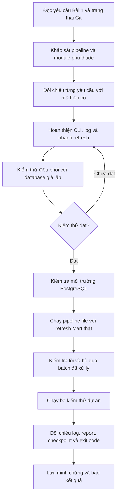

# Workflow AI — Bài 1: Pipeline Orchestration & CLI Entrypoint

Workflow cho Bài 1 trong [đề MD01-B8](../../assignments/MD01-B8_Bai-tap_Tu-dong-hoa-Daily-Pipeline-va-Tich-hop-End-to-End.md): khảo sát mã, hoàn thiện điều phối, kiểm thử và tạo minh chứng. Tài liệu ghi lại công việc đã thực hiện ngày 20/10/2026, kèm prompt và lệnh để tái sử dụng.

## 1. Phạm vi và tiêu chí hoàn thành

| Yêu cầu | Cách xác nhận |
|---|---|
| CLI đủ 4 tham số | `--help` hiển thị `--input-dir`, `--source`, `--refresh-mart`, `--skip-processed-file` |
| Giá trị mặc định và lựa chọn nguồn đúng | Input mặc định `data/incremental/day_2026-07-01`; source mặc định `file`, chỉ nhận `file`, `api`, `both` |
| Điều phối đủ 8 bước | Lần chạy đầy đủ có log `[1/8]` đến `[8/8]` |
| Phân luồng chất lượng dữ liệu | Dòng valid được upsert; dòng reject được ghi riêng theo `run_id` |
| Đối soát số dòng | `assert input == valid + rejected` cho từng dataset trước khi gọi `build_report()` |
| Log có thể truy vết | Có `run_id`, dataset và `input`, `valid`, `reject`, `inserted`, `updated` trong log thống kê |
| Làm mới Mart có điều kiện | Có cờ thì gọi `refresh_mart()`; không có cờ thì log `SKIPPED` |
| Checkpoint chỉ ghi khi thành công | Lỗi trước bước 8 giữ nguyên file state |
| Mã thoát đúng | Thành công trả 0; lỗi thực thi được `log.exception()` ghi lại và trả 1 |

Mã chính: [src/pipeline.py](../../src/pipeline.py). Module hỗ trợ cờ refresh: [src/refresh_mart.py](../../src/refresh_mart.py), tái sử dụng SQL Buổi 4 đang có trong repository.

## 2. Luồng làm việc của AI



### Bước 1 — Đọc yêu cầu và khảo sát hiện trạng

AI đọc đề, kiểm tra `git status --short` và các file sau:

- `src/pipeline.py`: parser, `run()`, `main()`, đọc/ghi state và các hàm trích xuất.
- `src/extract_files.py`, `src/transform.py`: đọc file và chuẩn hóa.
- `src/validators/`: kiểm tra schema, business rules, khóa ngoại và thời gian.
- `src/load_postgres.py`, `src/database.py`: upsert và ranh giới transaction.
- `src/quality_report.py`, `src/logger.py`, `src/config.py`: báo cáo, log và cấu hình.
- `tests/test_pipeline.py`, `tests/test_load_postgres.py`: hành vi đã có kiểm thử.
- `sql/student/04_data_mart.sql`: script Mart thực tế có trong dự án.

Khảo sát cho thấy pipeline đã có khung 8 bước và đủ 4 flags. Các khoảng trống cần bổ sung là `run_id` trong log thống kê, log đối soát chi tiết, module refresh đang thiếu và kiểm thử điều phối. Vì vậy, AI giữ lại các hàm xử lý đã có và bổ sung tại những điểm này.

**Prompt có thể dùng lại:**

> Đọc riêng yêu cầu Bài 1 của MD01-B8 và các module liên quan. Kiểm tra trạng thái Git trước khi sửa. Lập bảng yêu cầu, phần đã có và phần còn thiếu; giữ nguyên các thay đổi hiện có của người dùng. Xác định ranh giới transaction và điều kiện ghi checkpoint trước khi triển khai.

### Bước 2 — Hoàn thiện CLI và log theo phiên chạy

AI giữ `argparse` với bốn tham số, bổ sung giá trị mặc định vào phần help. Đường dẫn mặc định dùng `as_posix()` để hiển thị thống nhất trên Windows và Linux.

Nhánh `--help` được xử lý trước khi import các thư viện ETL/database. Kiểm thử chạy Python với `-S` xác nhận help vẫn hoạt động khi không nạp các package trong `site-packages`.

`main()` sinh UUID rồi truyền vào `run()`. `_RunLogger`, kế thừa `logging.LoggerAdapter`, thêm cùng `run_id` vào log điều phối. Khi `run()` được gọi trực tiếp, hàm vẫn tự sinh UUID nếu chưa nhận được mã chạy.

Luồng dữ liệu trong `run()`:

| Bước | Xử lý chính |
|---|---|
| `[1/8]` | Khởi tạo `run_id`, đọc state; kiểm tra bỏ qua batch file đã xử lý |
| `[2/8]` | Gọi `_source_frames()` theo nguồn đã chọn |
| `[3/8]` | `normalize()` và `validate_schema()` |
| `[4/8]` | Business → loại trùng PK → kiểm tra liên bảng; chuẩn bị valid/reject |
| `[5/8]` | Ghi `data/rejected/<run_id>/<dataset>_reject.csv` nếu có reject; upsert valid theo thứ tự phụ thuộc |
| `[6/8]` | Assert đối soát từng dataset, ghi log đẳng thức, gọi `build_report()` |
| `[7/8]` | Refresh Mart hoặc ghi `SKIPPED` |
| `[8/8]` | Ghi checkpoint thành công bằng file tạm rồi thay thế file state |

Thứ tự nạp là `customers`, `products`, `orders`, `order_items`, `payments`. Cột `status` của orders được ánh xạ sang `order_status` khi nạp Core; validator vẫn nhận tên cột `status` theo giao diện hiện có.

**Prompt có thể dùng lại:**

> Hoàn thiện src/pipeline.py theo 8 bước của Bài 1. Tái sử dụng các hàm hiện có, log cùng run_id cho mọi bước điều phối và đủ số liệu từng dataset. Giữ assert đối soát, gọi build_report sau đối soát, chỉ ghi state sau khi report và refresh thành công. Bọc thực thi bằng try/except, ghi log.exception khi lỗi và trả exit code đúng.

### Bước 3 — Bổ sung nhánh refresh có thể chạy

`src/refresh_mart.py` chưa tồn tại trong mã chính. Repository cũng chưa có `sql/solutions/12_load_data_mart.sql` được nhắc trong Bài 4, nhưng đã có script hoàn chỉnh `sql/student/04_data_mart.sql` từ Buổi 4.

AI tạo `refresh_mart()` để chạy script hiện có bằng kết nối database của dự án. Module loại các dòng `BEGIN;` và `COMMIT;` độc lập trong script để Python quản lý một transaction: commit khi thành công, rollback khi lỗi và luôn đóng kết nối trong `finally`.

Đây là tích hợp phục vụ cờ CLI Bài 1. Script đang dùng chiến lược **full refresh** Mart; phần nạp Mart gia tăng và bảng đối chiếu KPI của Bài 4 chưa được triển khai trong phạm vi này.

### Bước 4 — Kiểm thử điều phối và các nhánh lỗi

AI thêm [test_pipeline_orchestration.py](../../tests/test_pipeline_orchestration.py) và [test_refresh_mart.py](../../tests/test_refresh_mart.py). Các test điều phối dùng file và validator thật trong thư mục tạm; lời gọi upsert được giả lập để kiểm tra luồng xử lý mà không sửa database.

| Nhóm kiểm thử | Điều được xác nhận |
|---|---|
| CLI | Mặc định, truyền đủ flags, từ chối source ngoài danh sách; source sai trả mã 2 theo argparse |
| Help độc lập dependency | Subprocess dùng `-S` vẫn hiển thị đủ flags và trả 0 |
| Thành công có/không refresh | Chuẩn hóa đúng, ánh xạ tên cột orders, nạp theo thứ tự, report có trước checkpoint |
| Reject | Email sai và PK trùng được ghi CSV riêng; số dòng được bảo toàn |
| Lỗi từng giai đoạn | Trích xuất, schema, quality, load, report hoặc mart lỗi thì trả 1, state không đổi |
| Sai số dòng | Assert phát hiện mất cân bằng và dừng trước khi nạp |
| Batch đã xử lý | `--skip-processed-file` bỏ qua nạp và không ghi lại state |
| Log | Có đủ 8 bước, cùng run_id, trạng thái SKIPPED và thông điệp exit 0 |
| Transaction refresh | Thành công commit; lỗi rollback; cả hai trường hợp đều đóng kết nối |

**Prompt có thể dùng lại:**

> Viết kiểm thử cho hành vi của CLI và điều phối. Dùng tmp_path để cô lập file, dùng validator thật và giả lập ranh giới database. Kiểm tra thứ tự load/report/refresh/checkpoint, file reject, lỗi từng giai đoạn và state giữ nguyên. Kiểm tra refresh commit/rollback và đóng kết nối. Sau đó chạy các test liên quan và sửa mọi lỗi phát hiện được.

### Bước 5 — Chạy với PostgreSQL thật và tạo minh chứng

Ban đầu PostgreSQL bị timeout và Docker daemon chưa chạy. AI khởi động Docker Desktop; container `ecommerce-postgres` có sẵn khởi động lại. Sau đó pipeline file chạy thành công, gồm cả nhánh `--refresh-mart`.

Minh chứng được lấy từ stdout/stderr thực tế bằng `subprocess`, lưu UTF-8. Cách này tránh việc PowerShell định dạng các dòng log trên stderr thành `NativeCommandError` khi chuyển hướng trực tiếp.

AI cũng chạy subprocess với thư mục đầu vào không tồn tại: exit code bằng 1, log có `[ALERT]` và traceback, file state giữ nguyên theo byte. Chạy lại batch với `--skip-processed-file` trả 0, log `SKIPPED` và không thay đổi state.

**Prompt có thể dùng lại:**

> Kiểm tra môi trường Python và PostgreSQL, sau đó chạy pipeline --source file --refresh-mart. Lưu output --help và log chạy thực tế vào đúng đường dẫn minh chứng của đề, kèm exit code. Chạy thêm ca sai đường dẫn và ca bỏ qua batch đã xử lý; so sánh file state trước/sau. Không tạo log mẫu để thay thế kết quả chạy thật. Báo riêng các nhánh chưa được kiểm chứng.

## 3. Kết quả đã xác minh

Lần chạy thành công có `run_id=e803e5d8-406c-497a-a166-1ae32e3d1f35`:

| Dataset | Input | Valid | Reject | Inserted | Updated |
|---|---:|---:|---:|---:|---:|
| customers | 100 | 100 | 0 | 0 | 100 |
| products | 50 | 50 | 0 | 0 | 50 |
| orders | 600 | 600 | 0 | 0 | 600 |
| order_items | 1.533 | 1.533 | 0 | 0 | 1.533 |
| payments | 536 | 536 | 0 | 0 | 536 |
| **Tổng** | **2.819** | **2.819** | **0** | **0** | **2.819** |

Các ID đã tồn tại trong database nên lần chạy này ghi nhận `updated`, không có dòng mới được insert. Nhánh reject được xác nhận bằng kiểm thử có dữ liệu vi phạm, không xuất hiện trong batch sạch của lần chạy thật này.

- Nhóm test pipeline và refresh: **20 passed in 1.52s**.
- Toàn bộ bộ kiểm thử dự án: **129 passed in 5.14s**.
- Log đủ 8 bước, refresh Mart `OK`, checkpoint `OK`, **exit code 0**.
- `git diff --check` không phát hiện lỗi khoảng trắng.

Các kết quả trên thuộc phiên triển khai Bài 1; khi chạy lại cần ghi nhận số liệu mới từ môi trường lúc đó.

## 4. Cách tái hiện trong PowerShell

Chạy từ thư mục gốc dự án, dùng môi trường `.venv` đã cài `requirements.txt`. PostgreSQL cần có schema Core và dữ liệu nền của các buổi trước; không cần reset database.

```powershell
$pipelinePython = Join-Path $PWD '.venv/Scripts/python.exe'
$env:PYTHONIOENCODING = 'utf-8'
$env:PGCONNECT_TIMEOUT = '5'

# Kiểm thử riêng phần điều phối và refresh
& $pipelinePython -m pytest tests/test_pipeline.py tests/test_pipeline_orchestration.py tests/test_refresh_mart.py -q

# Chạy đầy đủ bộ kiểm thử, gồm các test PostgreSQL
& $pipelinePython -m pytest -q
```

Tạo lại hai file minh chứng bằng subprocess; lệnh này thực sự upsert batch, làm mới Mart và cập nhật checkpoint:

```powershell
@'
from pathlib import Path
import subprocess
import sys

jobs = [
    (["--help"], "08-help.txt"),
    (["--source", "file", "--refresh-mart"], "08-pipeline-log.txt"),
]
evidence = Path("docs/evidence")
evidence.mkdir(parents=True, exist_ok=True)
for args, filename in jobs:
    result = subprocess.run(
        [sys.executable, "-m", "src.pipeline", *args],
        stdout=subprocess.PIPE, stderr=subprocess.STDOUT,
        text=True, encoding="utf-8",
    )
    output = result.stdout
    if filename != "08-help.txt":
        output = f"Command: python -m src.pipeline {' '.join(args)}\n\n{output}\nExit code: {result.returncode}\n"
    (evidence / filename).write_text(output, encoding="utf-8")
    print(output)
    if result.returncode:
        sys.exit(result.returncode)
'@ | & $pipelinePython -
$LASTEXITCODE
```

Để kiểm tra nhánh lỗi và bỏ qua batch, có thể chạy lại hai lệnh dưới đây; kiểm tra state trước/sau bằng `Get-FileHash`:

```powershell
Get-FileHash metadata/pipeline_state.json
& $pipelinePython -m src.pipeline --input-dir data/__missing_batch_for_bai1__
$LASTEXITCODE  # Mong đợi: 1, nếu thư mục trên không tồn tại
Get-FileHash metadata/pipeline_state.json

& $pipelinePython -m src.pipeline --source file --skip-processed-file
$LASTEXITCODE  # Mong đợi: 0 và SKIPPED sau lần chạy thành công cùng batch
Get-FileHash metadata/pipeline_state.json
```

## 5. File bàn giao và phạm vi xác nhận

| Loại | File |
|---|---|
| Điều phối và CLI | [src/pipeline.py](../../src/pipeline.py) |
| Tích hợp refresh | [src/refresh_mart.py](../../src/refresh_mart.py) |
| Kiểm thử | [test_pipeline_orchestration.py](../../tests/test_pipeline_orchestration.py), [test_refresh_mart.py](../../tests/test_refresh_mart.py) |
| Help | [08-help.txt](../evidence/08-help.txt) |
| Log thành công | [08-pipeline-log.txt](../evidence/08-pipeline-log.txt) |
| State sau thành công | [pipeline_state.json](../../metadata/pipeline_state.json) |
| Báo cáo chất lượng | [CSV](../../reports/data_quality_report.csv), [JSON](../../reports/data_quality_summary.json) |

Transaction Core hiện áp dụng cho từng lần `upsert_dataframe()`, không bao trùm cả 8 bước. Vì vậy, lỗi ở report hoặc Mart giữ nguyên checkpoint nhưng không hoàn tác các bảng Core đã commit; lần chạy lại dựa vào upsert theo PK. Đây là điểm cần phân biệt khi đánh giá phục hồi.

Lần chạy database thật trong workflow này dùng nguồn `file`. CLI chấp nhận `api` và `both`, nhưng chưa có minh chứng chạy thật cho hai nguồn đó trong Bài 1. Các hạng mục multi-source, checkpoint nâng cao, KPI, cron và recovery đầy đủ thuộc Bài 2–6. Tài liệu này chưa bao gồm thao tác commit hoặc push.
