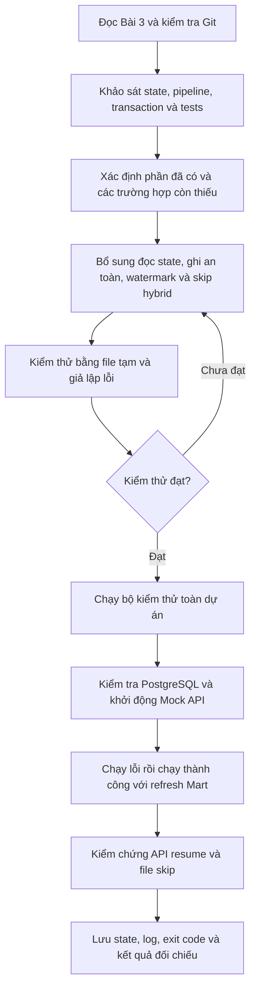

# Workflow AI — Bài 3: State & Checkpoint Management

Tài liệu ghi lại cách AI xử lý [Bài 3 của MD01-B8](../../assignments/MD01-B8_Bai-tap_Tu-dong-hoa-Daily-Pipeline-va-Tich-hop-End-to-End.md) ngày 20/10/2026: đọc yêu cầu, khảo sát cơ chế checkpoint đang có, bổ sung xử lý biên, kiểm thử và chạy minh chứng với PostgreSQL cùng Mock API thật.

## 1. Yêu cầu và tiêu chí hoàn thành

| Yêu cầu | Cách AI xác nhận |
|---|---|
| State đủ thông tin lần chạy thành công | Có `last_run_id`, `last_successful_at`, `last_source`, `status`, `api_watermarks`, `processed_file_batches` sau khi chạy thành công |
| Commit-on-Success | Chỉ gọi `_write_state()` sau nạp Core, đối soát, báo cáo và refresh Mart nếu được yêu cầu |
| Giữ state khi lỗi | So sánh nội dung file theo byte trước và sau lần chạy lỗi; CLI trả 1 |
| API resume | `updated_after` của từng dataset lấy từ watermark tương ứng trong state |
| File resume | `--skip-processed-file` bỏ qua đường dẫn batch đã ghi nhận thành công |
| Ghi checkpoint an toàn | Ghi file tạm trong cùng thư mục rồi thay thế; lỗi thay thế giữ nguyên checkpoint cũ |
| Watermark phản ánh dữ liệu đã nạp | Chỉ xét dòng valid, không lấy từ reject hoặc file master trong `both`; không ghi mốc nhỏ hơn mốc cũ |

Mã chính: [src/pipeline.py](../../src/pipeline.py). State thực tế: [metadata/pipeline_state.json](../../metadata/pipeline_state.json).

## 2. Luồng làm việc của AI



### Bước 1 — Khảo sát trước khi sửa

AI đọc đề, kiểm tra `git status --short`, rồi xem pipeline, state hiện tại, cấu hình, hàm chuẩn hóa timestamp, module upsert và các kiểm thử điều phối/nguồn dữ liệu.

Các chức năng đã có gồm đọc watermark theo dataset, lưu đường dẫn batch tuyệt đối bằng `Path.resolve()`, ghi state ở bước 8 và trả exit code 1 qua `main()` khi có exception. AI giữ lại khung xử lý này.

Những điểm cần bổ sung:

- `_read_state()` mới kiểm tra JSON ngoài cùng là dictionary; chưa kiểm tra kiểu của hai trường resume và giá trị watermark.
- `_write_state()` dùng một tên file tạm cố định, chưa flush/fsync và chưa dọn file tạm khi thay thế thất bại.
- `_watermark()` chọn cả cột `updated_at` nếu cột có dữ liệu; các dòng thiếu `updated_at` chưa được lấy `created_at` thay thế riêng.
- Gán watermark trực tiếp có thể làm mốc thời gian lùi nếu API trả lại dữ liệu cũ.
- Cờ bỏ qua batch mới áp dụng cho nguồn `file`; chế độ `both` vẫn đọc lại file danh mục đã xử lý.

**Prompt có thể dùng lại:**

> Đọc Bài 3 và các hàm _read_state, _write_state, _watermark, run. Kiểm tra Git trước khi sửa. Xác định thứ tự commit database và ghi checkpoint; đối chiếu hành vi khi lỗi, API rỗng, timestamp thiếu và nguồn both. Giữ lại phần đã đúng, bổ sung các trường hợp còn thiếu.

### Bước 2 — Kiểm tra state và ghi thay thế an toàn

AI bổ sung kiểm tra `api_watermarks` phải là dictionary, từng watermark phải là chuỗi thời gian phân tích được, `processed_file_batches` phải là danh sách chuỗi. JSON hỏng hoặc cấu trúc resume sai làm pipeline dừng; file cũ được giữ nguyên để tránh tự khởi động lại từ một checkpoint rỗng.

Nếu chưa có file state, `_read_state()` trả hai cấu trúc rỗng để hỗ trợ lần chạy đầu tiên. Những trường mô tả lần thành công được tạo khi pipeline hoàn tất.

Quy trình `_write_state()` sau chỉnh sửa:

1. Chuyển state thành JSON trước khi tạo file tạm.
2. Tạo file tạm có tên riêng bằng `NamedTemporaryFile()` trong thư mục metadata.
3. Ghi UTF-8, gọi `flush()` và `os.fsync()` trước khi đóng file.
4. Dùng `Path.replace()` thay thế checkpoint đích.
5. Dọn file tạm trong `finally` nếu vẫn còn.

Tên tạm riêng tránh xung đột tên file tạm. Cơ chế này chưa khóa toàn bộ pipeline khi nhiều tiến trình chạy đồng thời; xem giới hạn ở cuối tài liệu.

### Bước 3 — Tính watermark và tiếp tục từng nguồn

AI sửa `_watermark()` để ưu tiên `updated_at` trên từng dòng; nếu thiếu hoặc không phân tích được thì dùng `created_at` của chính dòng đó. Timestamp được quy về UTC trước khi lấy giá trị lớn nhất.

Ở bước 8, pipeline sao chép watermark cũ và chỉ thay giá trị của dataset nếu mốc từ tập valid lớn hơn mốc đã lưu. API trả rỗng hoặc không có timestamp hợp lệ thì giữ mốc cũ. Timestamp của dòng reject không được dùng để tăng watermark.

| Nguồn | Hành vi checkpoint và resume |
|---|---|
| `file` | Ghi đường dẫn batch sau thành công; nếu đã xử lý và có cờ skip thì trả `skipped`, không ghi lại state |
| `api` | Truyền watermark riêng vào `updated_after` cho cả 5 dataset; không thêm batch file |
| `both` | Chỉ cập nhật watermark của 3 dataset giao dịch; ghi nhận đường dẫn batch file |
| `both` có batch đã xử lý và cờ skip | Không đọc lại file master; tạo DataFrame master rỗng đủ schema và tiếp tục lấy API giao dịch, kiểm tra tham chiếu từ database |

Việc bỏ qua file ở chế độ `both` vẫn đi qua các bước điều phối chung với DataFrame master rỗng; ba dataset API tiếp tục xử lý bình thường.

**Prompt có thể dùng lại:**

> Hoàn thiện ghi state bằng file tạm riêng, flush/fsync và thay thế nguyên tử. Chỉ checkpoint sau khi toàn bộ các bước được yêu cầu thành công. Watermark lấy từ dòng valid, ưu tiên updated_at và fallback created_at từng dòng, không được lùi. Khi both bỏ qua batch file đã xử lý, vẫn tiếp tục các dataset API.

### Bước 4 — Kiểm thử tự động

AI thêm [test_pipeline_checkpoint.py](../../tests/test_pipeline_checkpoint.py) và bổ sung [test_pipeline_orchestration.py](../../tests/test_pipeline_orchestration.py). Các test dùng `tmp_path` cho state/RAW; giả lập ranh giới API, database hoặc thao tác thay file để tạo lỗi có kiểm soát.

| Nhóm kiểm thử | Điều xác nhận |
|---|---|
| Lần chạy đầu | State chưa có thì dùng cấu trúc resume rỗng, không tự tạo checkpoint thành công |
| State lỗi | JSON hỏng, sai kiểu dictionary/list hoặc watermark sai đều dừng và giữ nguyên file |
| Thay thế file thất bại | Phát sinh `OSError`, checkpoint cũ giữ nguyên byte và file tạm được dọn |
| Timestamp | Xử lý múi giờ, fallback từng dòng và DataFrame rỗng |
| Watermark thành công | Dữ liệu cũ không làm mốc lùi; dòng email sai có timestamp mới hơn không làm tăng watermark |
| Hybrid skip | Xóa file đầu vào sau lần chạy thành công; `both` có cờ skip vẫn gọi đúng 3 dataset API |
| Lỗi từng giai đoạn, đã có từ Bài 1 | Lỗi extract/schema/quality/load/report/mart trả 1 và giữ checkpoint |
| Thứ tự checkpoint, đã có từ Bài 1 | Report và refresh được thực hiện trước khi state thay đổi |

Kết quả trong phiên triển khai Bài 3:

- Bộ test checkpoint, orchestration và sources: **32 passed in 2.00s**.
- Toàn bộ dự án: **148 passed in 8.41s**.
- `git diff --check` không báo lỗi khoảng trắng.

Đây là kết quả đã quan sát trong phiên triển khai, không phải kết quả chạy lại khi viết tài liệu. Số lượng test và thời gian có thể thay đổi theo phiên bản repository.

### Bước 5 — Chạy thật và tạo minh chứng

AI kiểm tra cổng dịch vụ: PostgreSQL ở `localhost:5432` hoạt động, Mock API ở cổng 8000 chưa chạy. AI khởi động Uvicorn tạm thời, rồi chạy [scripts/demo_checkpoint.py](../../scripts/demo_checkpoint.py).

Script gọi CLI qua subprocess, ghi stdout/stderr bằng UTF-8, lưu exit code và chụp nội dung state vào [08-checkpoint.txt](../evidence/08-checkpoint.txt).

| Thứ tự | Kịch bản thực tế | Kết quả |
|---|---|---|
| 1 | Nguồn file với thư mục không tồn tại | Exit 1; state trước/sau giống nhau theo byte |
| 2 | `--source both --refresh-mart` | Exit 0; Core, báo cáo và Mart hoàn tất trước khi checkpoint cập nhật |
| 3 | `--source api --refresh-mart` | Exit 0; snapshot RAW của từng dataset chứa `updated_after` đúng bằng watermark vừa đọc |
| 4 | `--source file --skip-processed-file` | Exit 0; batch được bỏ qua, state không đổi |

Trong lần API resume, cả 5 dataset trả 0 dòng vì state đã có watermark tới cuối dữ liệu Mock API. Vì vậy, minh chứng thật xác nhận dùng đúng mốc cũ và giữ nguyên watermark khi không có dữ liệu mới. Việc tạo watermark mới, loại timestamp của reject và chống lùi được kiểm chứng bằng test cô lập; phiên chạy thật này không chứng minh watermark tăng với dữ liệu API mới.

Sau khi kiểm chứng, AI dừng Mock API đã khởi động. Những lần chạy thành công thực hiện upsert Core, refresh Mart, cập nhật report, RAW và state thực tế trong workspace.

**Prompt có thể dùng lại:**

> Chạy kiểm thử liên quan rồi toàn bộ dự án. Với PostgreSQL và Mock API thật, mô phỏng sai đường dẫn file, so sánh state theo byte và kiểm tra exit 1. Sau đó chạy both có refresh Mart, chạy API resume và file skip. Lưu stdout/stderr, exit code, state trước/sau và kiểm tra updated_after trong RAW. Phân biệt rõ điều đã chứng minh bằng test và điều đã quan sát bằng dịch vụ thật.

## 3. Cách tái hiện trong PowerShell

Chạy từ gốc repository, với dependency đã cài trong `.venv`, cấu hình `.env` phù hợp và PostgreSQL đã có schema/dữ liệu nền. Mở terminal thứ nhất cho Mock API:

```powershell
.\.venv\Scripts\python.exe -m uvicorn mock_api.app:app --host 127.0.0.1 --port 8000
```

Trong terminal thứ hai:

```powershell
.\.venv\Scripts\python.exe -m pytest tests/test_pipeline_checkpoint.py tests/test_pipeline_orchestration.py tests/test_pipeline_sources.py -q
.\.venv\Scripts\python.exe -m pytest -q
.\.venv\Scripts\python.exe scripts/demo_checkpoint.py
$LASTEXITCODE
Get-Content docs/evidence/08-checkpoint.txt
Get-Content metadata/pipeline_state.json
```

Script demo cần có file state ban đầu để chụp trước/sau. Nếu triển khai mới chưa có state, chạy một lần pipeline thành công với batch hợp lệ trước khi dùng demo. Demo thực hiện upsert và refresh Mart thật, cập nhật checkpoint, đồng thời ghi đè file evidence bằng kết quả lần chạy mới. Không cần xóa hoặc lùi watermark để tái hiện.

## 4. Giới hạn cần hiểu khi đọc kết quả

Checkpoint chỉ cập nhật sau thành công toàn luồng, nhưng mỗi dataset Core đang có transaction riêng và Mart có transaction riêng. Lỗi ở dataset sau hoặc Mart có thể xảy ra sau khi một số bảng Core đã commit; state vẫn cũ để lần sau đọc lại cùng mốc và upsert lại. Toàn bộ pipeline chưa phải một transaction chung giữa database và file state.

Ghi thay thế an toàn giảm nguy cơ JSON bị ghi dở, nhưng chưa có khóa ngăn hai pipeline cùng đọc state cũ rồi ghi đè kết quả của nhau. Phạm vi kiểm chứng hiện tại là các lần chạy tuần tự.

Watermark lấy giá trị lớn nhất của các dòng valid. Bản ghi bị reject có timestamp nhỏ hơn watermark mới cần được sửa và phát lại với timestamp mới, hoặc được xử lý qua quy trình nạp lại riêng; bài này chưa triển khai hàng đợi retry cho reject.

## 5. Các file để đối chiếu

| Hiện vật | Nội dung |
|---|---|
| [src/pipeline.py](../../src/pipeline.py) | Đọc/ghi state, tính watermark, commit-on-success và skip file/hybrid |
| [pipeline_state.json](../../metadata/pipeline_state.json) | Checkpoint của lần chạy thành công thực tế |
| [test_pipeline_checkpoint.py](../../tests/test_pipeline_checkpoint.py) | State lỗi, ghi file thất bại và timestamp biên |
| [test_pipeline_orchestration.py](../../tests/test_pipeline_orchestration.py) | Thứ tự checkpoint, giữ state khi lỗi, hybrid skip và watermark từ valid |
| [test_pipeline_sources.py](../../tests/test_pipeline_sources.py) | Truyền watermark vào API và bảo toàn RAW |
| [demo_checkpoint.py](../../scripts/demo_checkpoint.py) | Kịch bản kiểm chứng bằng CLI với dịch vụ thật |
| [08-checkpoint.txt](../evidence/08-checkpoint.txt) | Log, exit code, state trước/sau và kết quả so sánh |

Workflow tiếp nối [Bài 2: Multi-Source Ingestion & RAW Capture](08-multi-source-ingestion-raw-capture-workflow.md), tập trung vào điều kiện ghi nhận thành công và cách tiếp tục từ checkpoint.
